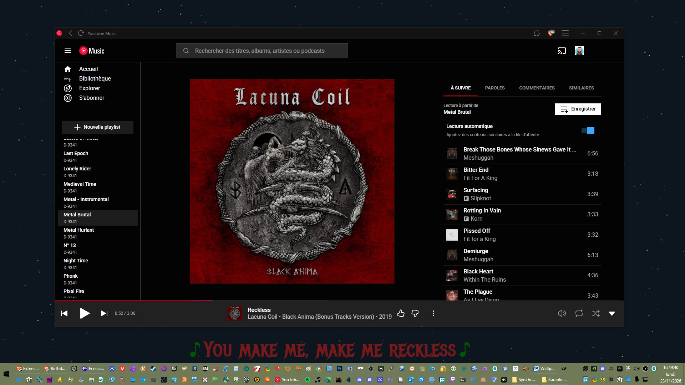
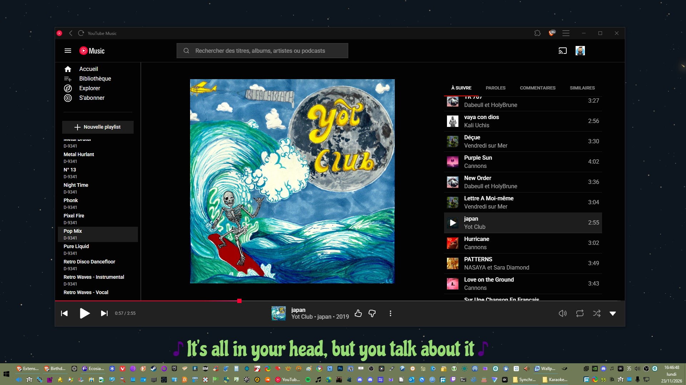
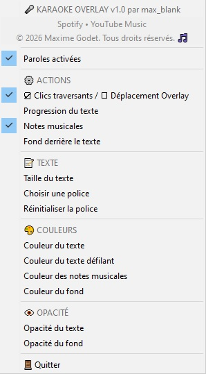

# Karaoke-Overlay

If you would like to see the description in english, click here. → [Follow this link !](README.md)

Karaoke-Overlay est un programme en python simple et léger qui permet d'afficher les paroles d'une musique en cours provenant de la version navigateur de Youtube Music ou Spotify, façon karaoké, sur une position donnée de l'écran, grace à un système d'overlay personnalisable, et directement contrôlable depuis la zone de notification.

Cette application a été "vibe codée" entièrement, autrement je n'aurais pas pu la mettre en place, mes connaissances en développement étant insuffisantes, et ma patience, mon temps et mon attention limités concernant l'apprentissage d'une quelconque forme de code.

Je l'ai faite avant tout pour répondre à un besoin personnel, et pour enfin sortir de ma tête cette idée que j'avais depuis un moment, et pour laquelle je ne trouvais pas d'applications existantes proposant cela.

## 📸 Aperçu

 
 

## 🛠️ Technologies utilisées

Ce projet a été réalisé avec :

- ⚡ Python
- 🖥️ Inno Setup
- 📦 pyinstaller
- ⚙️ npm
- Et d'autres :
certifi==2026.7.22
charset-normalizer==3.5.1
idna==3.19
PySide6==6.11.2
PySide6_Addons==6.11.2
PySide6_Essentials==6.11.2
requests==2.34.2
shiboken6==6.11.2
urllib3==2.7.0
websockets==17.1

- ❤️ Une pointe de passion.

## ✨ Présentation

J'ai mis en place ce petit programme en python simple et léger qui permet d'afficher les paroles d'une musique 
en cours provenant de la version navigateur de Youtube Music ou de Spotify, façon karaoké, sur une position donnée de l'écran.

Il se comporte comme un overlay qui affiche les paroles d'une musique en cours de manière synchronisée, mais ne gêne pas l'utilisateur qui peut toujours cliquer au travers.

Le programme fonctionne avec une extension de navigateur, le service worker indique alors : "Connecté au programme Python."
J'utilise Spotify et Youtube music directement depuis mon navigateur internet (Brave). 
Je précise bien : CE PROGRAMME N'EST PAS FAIT POUR FONCTIONNER AVEC LES INSTALLATEURS SPOTIFY ET YOUTUBE, SEULEMENT DEPUIS LES PAGES WEB.

## 🚀 Fonctionnalités principales

Une fois ouvert, le programme se fixe discrètement au systray. Un clic gauche sur l'icône (une note de musique) permet d'afficher ou masquer instantanément l'affichage des paroles, tandis qu'un clic droit sur l'icone permet de faire apparaitre un menu contextuel pour modifier une multitudes de préférences, comme par exemple ajuster les couleurs du texte ou de son arrière plan, la police, la taille et la transparence.

 

Il est possible également d'afficher la progression des paroles en mode défilement, ou la couleur d'un texte de fond est progressivement remplacée à mesure que la musique progresse.

On peut aussi déplacer la position de l'overlay (du texte) ou la verrouiller. Quand la position est verrouillée, les clics traversants sont alors activés et permettent de ne pas gêner les clics de l'utilisateur. Tous les réglages du systray sont fonctionnels et sauvegardables.

## 🛠️ Installation

1. Rendez-vous dans la section [Versions](../../releases) de ce dépôt.
2. Téléchargez le dernier exécutable Windows ainsi que l'archive contenant l'extension à ajouter au navigateur.
3. Lancez l'executable pour commencer l'installation du Karaoke Overlay, mais ne lancez pas l'application tout de suite une fois installée.
4. Il convient maintenant d'ajouter l'extension à votre navigateur pour faire la liaison entre le navigateur et l'appli. Allez donc dans les options d'extension du navigateur internet que vous utilisez.
-Pour un navigateur Chromium : Il faut d'abord extraire le dossier de l'archive contenant l'extension. Mettez le où vous voulez. Allez ensuite sur votre navigateur, puis dans "Extensions", puis "Gérer les extensions". Une fois sur la page dédiée, cochez le mode développeur en haut à droite, puis choisissez "Charger l'extension non empaquetée" et sélectionnez le dossier de l'extension.
-Pour un navigateur Firefox : ???
6. Lancez l'application Karaoké-Overlay. Une icone avec une note de musique devrait apparaitre en bas à droite dans la zone de notification.

**VIRUSTOTAL :**  
COMING SOON

## ⚠️ Limitations connues

- L'application n'est disponible que pour Windows actuellement.
- L'overlay n'est fait pour fonctionner qu'avec les versions Web/WebApp de Spotify et Youtube Music, pas pour les applications.
- L'installation
- Il arrive que le fournisseur de paroles ne trouve pas toujours les paroles d'une musique. Changer de musique et revenir peut solutionner le problème.
- Le défilement des paroles ne permet pas de faire du mot à mot, je n'ai pas trouvé de solution pour faire cela et de suivre/avancer exactement et précisément quand une personne parle. Le défilement avance proportionnellement en fonction de la longueur qui a été attribué à chaque ligne des paroles.

## 🚀 Améliorations possibles à l’avenir

- Ouvrir l'application pour Linux, Apple ou Android.
- Ajouter d'autres fournisseur de paroles afin de renforcer la fiabilité d'un potentiel match.
- Arriver à faire en sorte que le mot à mot fonctionne parfaitement donnerai vraiment cette impression de Karaoké immersif.
- Automatiser l'installation de l'extension, qui demanderait à l'utilisateur quel navigateur il utilise, et proposerait alors une installation adaptée.

## 🤝 Contribution

👤 Bonjour, je suis max-blank, et il s’agit de ma seconde application pour Windows. La première étant un Birthday Reminder réalisé en Electron.js.

Je suis complètement novice dans tout cela : le code, l’utilisation de GitHub et tout le reste. Mais je fais de mon mieux !

Si vous appréciez ce que j’ai réalisé, souhaitez me soutenir et m’aider et m'encourager à créer davantage de projets de ce type :

- 🧡 [Ko-fi](https://ko-fi.com/oxoxo)
- 💙 [PayPal](https://paypal.me/maxblank0)

## 📄 Licence

?
