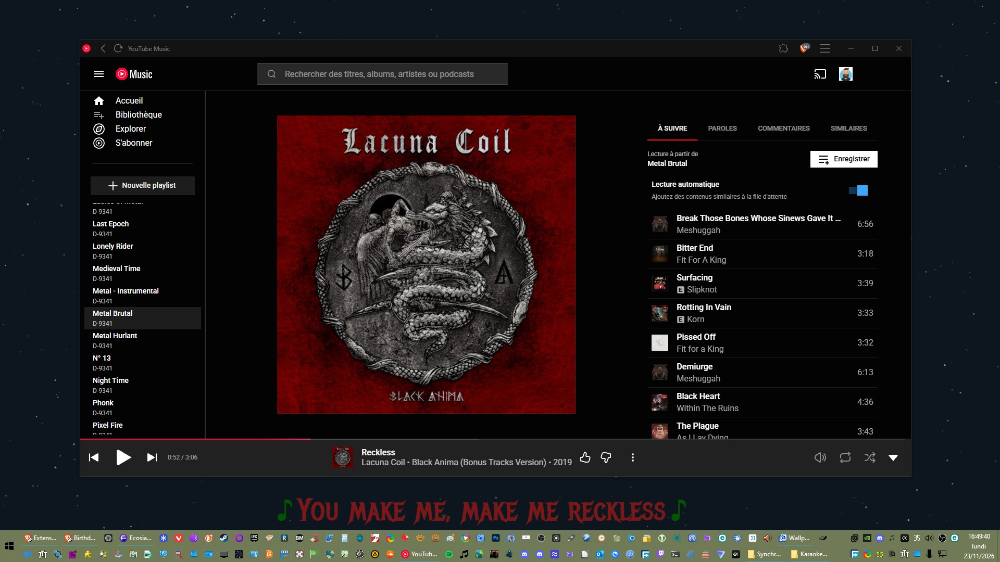
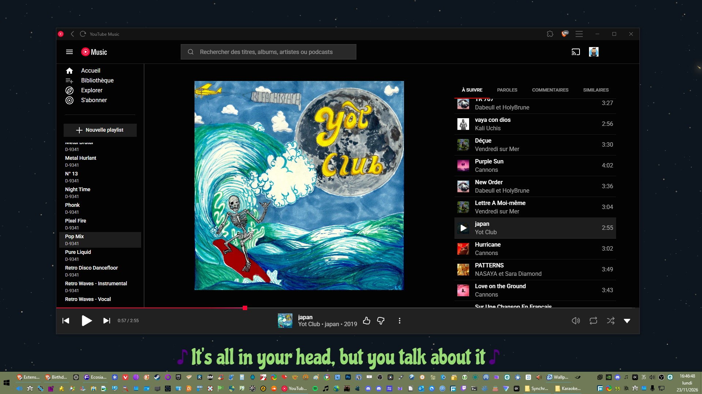
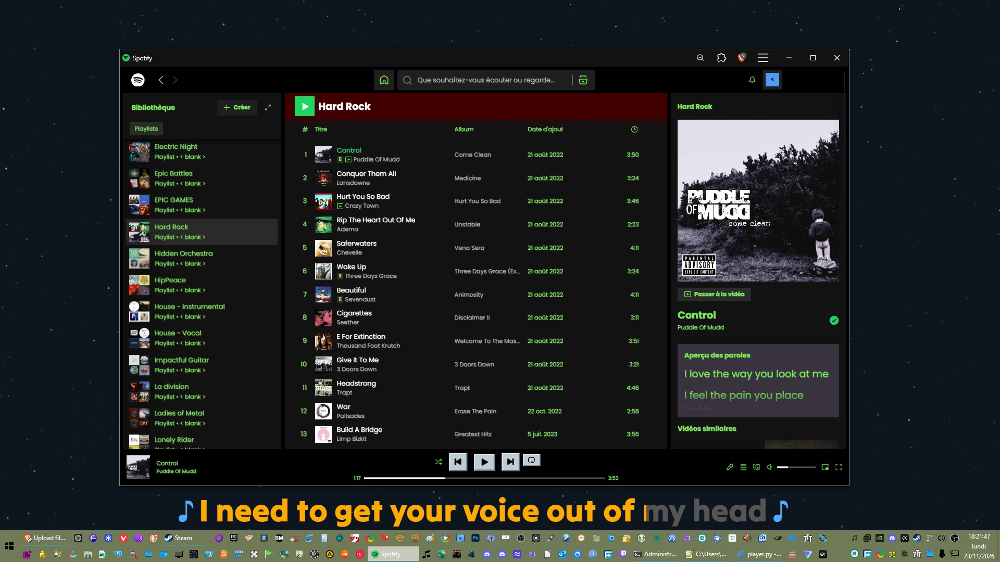
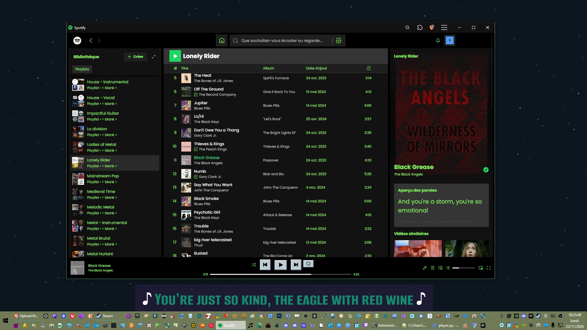
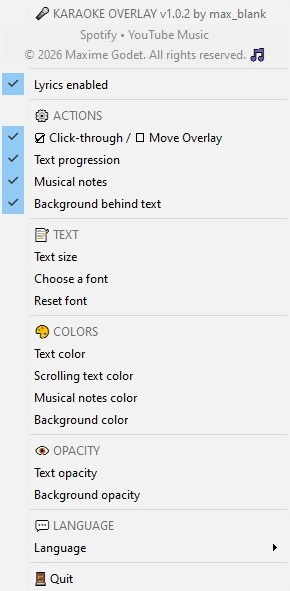

# 🎤 Karaoke-Overlay 🎤

Si vous souhaitez une description en français, cliquer ici -> [Suivez ce lien !](README%20-%20FRENCH.md)

Karaoke-Overlay is a simple, lightweight Python program that displays lyrics from a song playing in the web version of YouTube Music or Spotify. Like a karaoke display, the lyrics appear in a chosen position on your screen in a customizable overlay, which can be controlled directly from the system tray.

I created this application entirely through “vibe coding”; otherwise, I wouldn’t have been able to build it, since my programming skills are limited and I have limited patience, time, and attention for learning to code.

I made it primarily to meet a personal need and finally bring to life an idea I’d had for a while, but for which I couldn’t find an existing application.

## 📸 Preview

 
 
 
 

## 🛠️ Technologies used

This project was built with:

- ⚡ Python + JavaScript
- 🖥️ Inno Setup
- 📦 PyInstaller
- ⚙️ npm
- And other dependencies:
certifi==2026.7.22
charset-normalizer==3.5.1
idna==3.19
PySide6==6.11.2
PySide6_Addons==6.11.2
PySide6_Essentials==6.11.2
requests==2.34.2
shiboken6==6.11.2
urllib3==2.7.0
websockets==17.1
- ❤️ And a little passion.

## ✨ Overview

I created this simple, lightweight Python program to display lyrics from a song playing in the web version of YouTube Music or Spotify, karaoke-style, at a position of your choice on the screen.

It works as an overlay that displays synchronized lyrics without getting in your way: you can still click through it.

The program works with a browser extension. When connected, the service worker displays the message: “Connected to the Python program.”
I use Spotify and YouTube Music directly in my browser (Brave).
To be clear: THIS PROGRAM IS NOT DESIGNED TO WORK WITH THE SPOTIFY OR YOUTUBE APPS—ONLY WITH THEIR WEB PAGES.

## 🚀 Main features

Once launched, the program sits quietly in the system tray. Left-click the music-note icon to show or hide the lyrics instantly. Right-click it to open a context menu and adjust various settings, such as text and background colors, font, size, and transparency.

 

You can also display the lyrics in scrolling mode, where the foreground text color gradually replaces the background text color as the song progresses.

You can move the overlay (the lyrics) or lock it in place. When its position is locked, click-through is enabled so the overlay won’t interfere with your clicks. All system-tray settings work and can be saved.

## 🛠️ Installation

1. Go to the [Releases](../../releases) section of this repository.
2. Download the latest Windows installer and the archive containing the browser extension.
3. Run the installer to install Karaoke-Overlay, but don’t launch the application yet.
4. Add the extension to your browser to connect it to the app. Open your browser’s extension settings.
- For Chromium-based browsers: First extract the extension archive to a folder wherever you like. Then open your browser’s Extensions page and select “Manage extensions”. Turn on Developer mode in the top-right corner, choose “Load unpacked”, and select the extension folder.
- For Firefox: Haven't found a simple solution yet, as the procedure is fairly annoying in order to add a non signed extension.
5. Launch Karaoke-Overlay. A music-note icon should appear in the system tray at the bottom-right of your screen.

**VIRUSTOTAL:**  
COMING SOON

## ⚠️ Known limitations

- The application is currently available only for Windows.
- The overlay is designed to work only with the web versions/web apps of Spotify and YouTube Music, not their desktop applications.
- Installation
- The lyrics provider may not always find lyrics for a song. Changing to another song and then back again may solve the problem.
- Scrolling lyrics do not support word-by-word highlighting. I haven’t found a way to track speech precisely enough to achieve that. Instead, the highlighting progresses proportionally according to the assigned length of each lyric line.

## 🚀 Possible future improvements

- Make the application available for Linux, Apple platforms, or Android.
- Add other lyric providers to improve the chances of finding a match.
- Make word-by-word highlighting work perfectly, which would create a much more immersive karaoke experience.
- Automate the extension installation by asking users which browser they use and then offering the appropriate installation method.

## 🤝 Contributions

👤 Hi, I’m max-blank, and this is my second Windows application. My first was Birthday Reminder, made with Electron.js.

I’m a complete beginner at all of this—the code, using GitHub, and everything else. But I’m doing my best!

If you like what I’ve made and would like to support, help, or encourage me to create more projects like this:

- 🧡 [Ko-fi](https://ko-fi.com/oxoxo)
- 💙 [PayPal](https://paypal.me/maxblank0)

## 📄 License

Proprietary License, © 2026 Maxime Godet, All right reserved.
